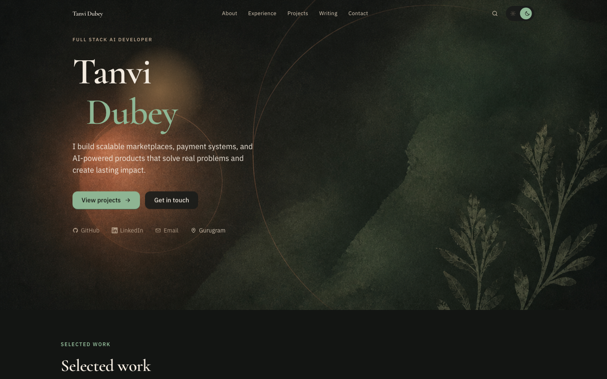
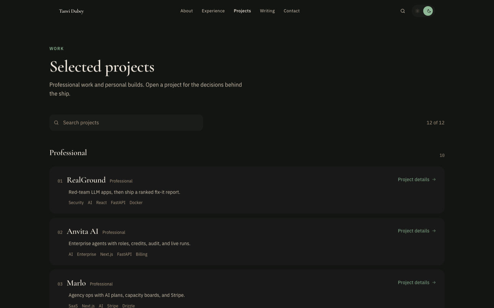
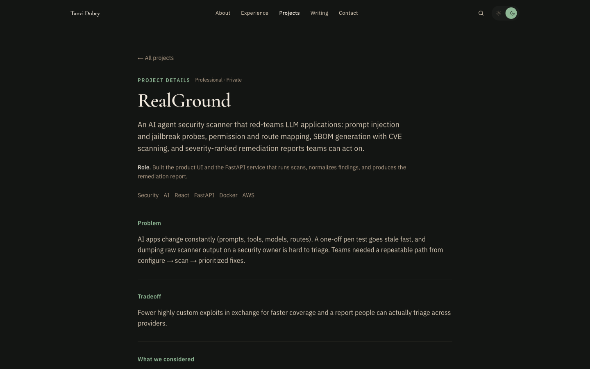
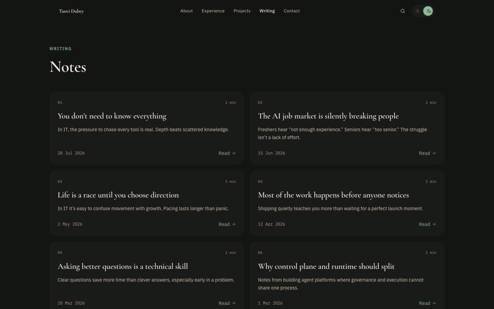

# Tanvi Dubey — Portfolio

Personal portfolio: selected work, writing, and a short about page.

**Live:** https://tanvvi-dubey.vercel.app/

## Screenshots

### Home



### Projects



### Project details



### Writing



## Stack

Next.js 14 (App Router) · TypeScript · Tailwind · Zod · Vitest · Playwright · Resend

## Structure

- **App shell:** simple nav (Work · Writing · About), optional search (⌘K), theme toggle.
- **Content:** typed modules in `src/content/` + MD writing in `content/writing/`.
- **APIs:** `/api/contact`.

## Setup

```bash
npm install
cp .env.example .env.local   # optional RESEND_API_KEY for contact
npm run dev
```

```bash
npm run lint
npm run typecheck
npm run test
npm run build && npm start
npx playwright install chromium
npm run test:e2e
```

## Env

| Variable | Required | Notes |
|----------|----------|-------|
| `RESEND_API_KEY` | for contact delivery | Without it, form returns 503 (no fake success) |
| `CONTACT_FROM_EMAIL` | no | Verified Resend sender |
| `CONTACT_TO_EMAIL` | no | Defaults to site email |

## Routes

`/` · `/work` · `/work/[slug]` · `/writing` · `/stack` · `/about`

`/projects/*` redirects to `/work/*`. `/lab/*` redirects home.
